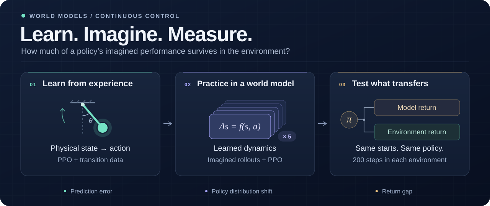
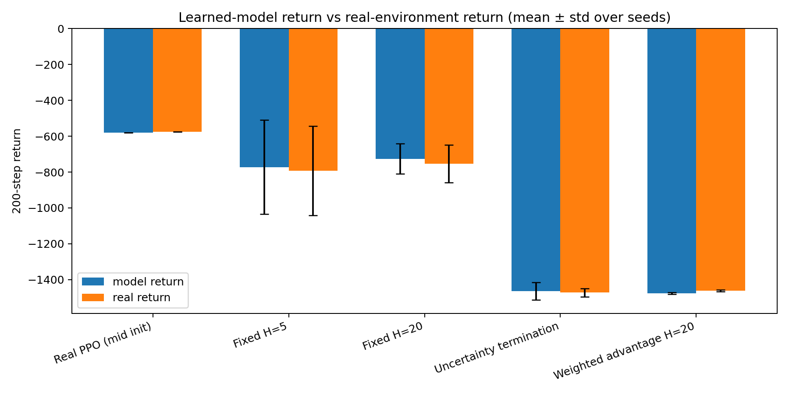
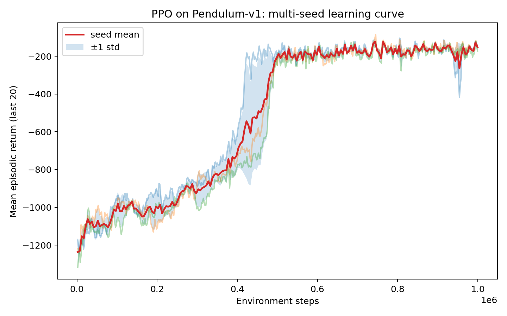
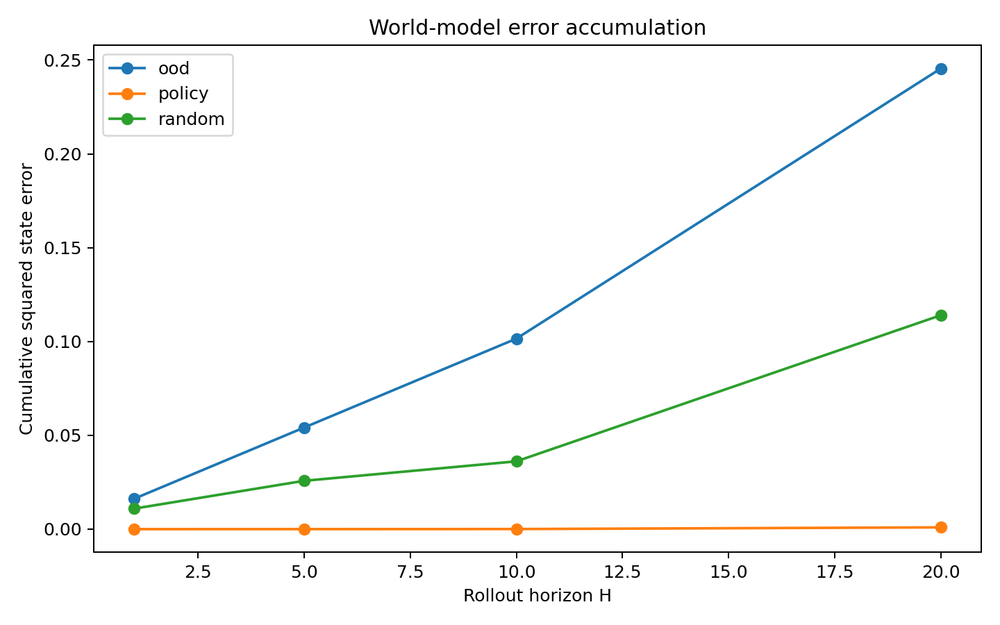

<div align="center">

# World-Model RL

**Reliable policy learning under imperfect dynamics**

Continuous control · Learned world models · Uncertainty · Distribution shift

[Technical report](docs/world_model_rl_study.pdf) · [Results](#what-the-experiments-show) · [Mathematics](#inside-the-method) · [Code](#explore-the-code) · [Get started](#get-started)

</div>



An embodied agent can use a world model to practice before acting. The challenge is deciding how much of that practice will help in the environment.

This project studies that question in **Pendulum-v1**, a continuous-control task with angle, angular velocity, and bounded torque. It connects **PPO, learned dynamics, imagined policy refinement, and matched evaluation** in a compact PyTorch implementation built from scratch.

**The central finding: model–environment agreement and good control are separate quantities.** A policy can have a small return gap while performing poorly in both worlds. The experiments measure both, then examine how data coverage, rollout length, and uncertainty controls affect the outcome.

| Control | World modeling | Research design |
| :--- | :--- | :--- |
| Tanh-Gaussian PPO with GAE and reward normalization | Five dynamics models with state geometry constraints | Four refinement methods, two policy initializations, paired evaluation |
| **−153.0 ± 4.4** return across three PPO seeds | Policy, random-action, and extreme-torque datasets | **200-step** comparisons from the same initial states |

## The research question

**When a policy learns inside an imperfect world model, what carries over to the environment?**

The experiment separates three parts of that question:

1. **Prediction:** how does dynamics error change as actions move beyond the model's training data?
2. **Optimization:** how do rollout length and ensemble disagreement change policy updates?
3. **Control:** does the resulting policy earn more reward under the environment's dynamics?

The world model learns state transitions. Imagined rollouts use the exact Pendulum reward, so the comparison focuses on learned dynamics and policy optimization. Here, **environment return** means evaluation in the original Gymnasium simulator.

## What the experiments show

### 1. Measure performance alongside the return gap

Each policy is evaluated under learned and environment dynamics using the same initial states, deterministic actions, and 200-step horizon. Define

$$
G(\pi)=J_{\mathrm{model}}(\pi)-J_{\mathrm{env}}(\pi).
$$

A positive gap means the model overestimates the policy's return. The code calls this quantity the *exploitation gap*.

For any policy update, let $\Delta$ denote the change from the old policy to the new one. The definition gives a useful accounting identity:

$$
\underbrace{\Delta J_{\mathrm{env}}}_{\text{gain in the environment}}
=
\underbrace{\Delta J_{\mathrm{model}}}_{\text{gain in imagination}}
-
\underbrace{\Delta G}_{\text{change in model optimism}}.
$$

This explains why both return and gap matter when judging an update.

The main comparison starts from a partially trained PPO policy and refines it for approximately 500,000 imagined transitions. The dynamics model stays fixed and was trained on data from a stronger policy.

| Refinement method | Environment return ↑ | Model − environment return | Final rollout length |
| :--- | ---: | ---: | ---: |
| **Starting policy** | **−576.4** | −3.0 | — |
| Fixed horizon, H = 5 | −792.4 ± 248.7 | +20.0 ± 22.2 | 5.0 |
| Fixed horizon, H = 20 | −753.8 ± 105.5 | +27.7 ± 20.7 | 20.0 |
| Uncertainty termination | −1472.7 ± 24.1 | +8.9 ± 25.6 | 4.3 |
| Uncertainty-weighted advantage | −1462.1 ± 4.2 | −13.4 ± 1.2 | 20.0 |

Values are mean ± sample standard deviation across **three refinement seeds**, each evaluated on 50 matched episodes. The starting policy is one shared checkpoint. Final rollout length averages the last 20 completed training segments per seed.



**All four methods reduce environment return from the starting policy in this setting.** Uncertainty termination shortens rollouts to about four steps. Advantage weighting also produces poor control despite a small return gap. These results make the trade-off concrete: uncertainty controls change the training signal, and their value must be judged by the resulting behavior.

With the stronger policy as the starting point, fixed H = 20 and uncertainty termination retain returns near −150. Fixed H = 5 and weighted advantages reach about −296 and −289. This comparison uses one refinement run per method.

[Three-seed results](runs/comparison_seeds/comparison_aggregated.csv) · [Strong-policy comparison](runs/comparison/comparison.md)

### 2. Connect prediction error to data coverage

The ensemble trains on a 60,000-transition dataset collected by the strong PPO policy, split by episode into training and validation. Two additional datasets probe random actions and extreme torques.

| Evaluation dataset | Transitions | One-step state MSE ↓ | Mean ensemble disagreement |
| :--- | ---: | ---: | ---: |
| Policy data | 60,000 | 1.96 × 10⁻⁶ | 1.17 × 10⁻⁶ |
| Uniform random actions | 30,000 | 2.97 × 10⁻³ | 2.19 × 10⁻⁴ |
| Extreme torques | 30,000 | 5.17 × 10⁻³ | 3.85 × 10⁻⁴ |

Prediction error and disagreement both increase outside the policy-data distribution. The policy row evaluates the full source dataset, including training transitions. Together, these measurements motivate checking uncertainty on the states and actions a refining policy actually visits.

| Learning a control policy | Predicting over longer rollouts |
| :---: | :---: |
|  |  |
| PPO reaches **−153.0 ± 4.4** across seed means, with 30 evaluation episodes per seed. Random actions average **−1198.6**. | Policy-data errors remain below both shifted datasets at all measured horizons. The plotted error averages squared state distance over the rollout. |

[PPO evaluation](runs/ppo_summary/evaluation.csv) · [One-step prediction](runs/world_model_eval/one_step_results.csv) · [Rollout prediction](runs/world_model_eval/rollout_results.csv)

## Inside the method

### Continuous control with bounded actions

The policy samples a Gaussian latent action and maps it to the torque range:

$$
z\sim\mathcal N\!\left(\mu_\theta(s),\sigma_\theta^2\right),
\qquad a=2\tanh z.
$$

The implementation includes the change-of-variables correction in the action log probability, GAE advantages, clipped policy and value objectives, and KL-based early stopping. Reward normalization scales the training signal. Evaluation reports the original environment reward.

<details>
<summary><strong>From the action density to the PPO update</strong></summary>

For Pendulum's scalar action, the transformed density is

$$
\log\pi_\theta(a\mid s)
=\log\mathcal N(z;\mu_\theta(s),\sigma_\theta^2)
-\log\!\left(2(1-\tanh^2 z)\right).
$$

The mean depends on the state. The learned standard deviation is shared across states. The code adds a small numerical stabilizer inside the logarithm.

PPO uses the corrected density to form the likelihood ratio

$$
\rho_t(\theta)=\frac{\pi_\theta(a_t\mid s_t)}{\pi_{\theta_{\mathrm{old}}}(a_t\mid s_t)}.
$$

$$
L^{\mathrm{clip}}=\mathbb E_t\!\left[
\min\!\left(\rho_t\hat A_t,\mathrm{clip}(\rho_t,1-\epsilon,1+\epsilon)\hat A_t\right)
\right].
$$

The implementation maximizes this surrogate with normalized GAE advantages and jointly fits the critic.

[Policy and density](ppo_core.py) · [PPO training](train_ppo.py)

</details>

### Dynamics with physical state geometry

The observation is $s=(\cos\varphi,\sin\varphi,\dot\varphi)$. Each ensemble member learns a normalized state increment, then projects its prediction:

$$
\hat s_{t+1}^{(j)}=\Pi\!\left(s_t+f_{\phi_j}(s_t,a_t)\right),
\qquad j=1,\ldots,5.
$$

Here, $f_{\phi_j}$ includes input normalization and output rescaling. The projection normalizes each member's angular coordinates and clips angular velocity to the environment range. The ensemble mean supplies the next imagined state.

Each member trains on a bootstrap sample. Splitting complete episodes between training and validation keeps neighboring transitions from the same episode together.

[Dynamics and projection](world_model.py) · [Ensemble training](train_world_model.py)

### Uncertainty as a control on learning

Disagreement among the five predictions supplies an uncertainty proxy:

$$
u(s,a)=\frac{1}{3}\sum_{k=1}^{3}\mathrm{Var}_{j}\!\left[\hat s_{k}^{(j)}\right].
$$

The experiments compare fixed rollouts against two ways to use this signal:

- **Terminate:** end an imagined segment when disagreement exceeds the validation-set 95th percentile, $\tau\approx6.63\times10^{-6}$, or the horizon limit.
- **Weight:** multiply normalized policy advantages by $w_t=\max\{0.02,\exp(-\beta u_t/\tau)\}$ while retaining the full rollout.

Termination also cuts the critic's continuation value at the segment boundary. Weighting acts on the policy objective while the critic keeps its usual loss. These choices connect uncertainty directly to credit assignment and optimization.

[Imagined environment](imagined_env.py) · [Policy refinement](train_imagined_ppo.py)

## Explore the code

| Start here | What to look for |
| :--- | :--- |
| [`ppo_core.py`](ppo_core.py) · [`train_ppo.py`](train_ppo.py) | Action distributions, actor–critic learning, reward scaling |
| [`collect_transitions.py`](collect_transitions.py) | Policy, random-action, and extreme-torque data collection |
| [`world_model.py`](world_model.py) · [`train_world_model.py`](train_world_model.py) | Residual dynamics, state projection, ensemble disagreement |
| [`imagined_env.py`](imagined_env.py) · [`train_imagined_ppo.py`](train_imagined_ppo.py) | Model-based rollouts and the four refinement variants |
| [`compare_imagined_methods.py`](compare_imagined_methods.py) · [`aggregate_comparison.py`](aggregate_comparison.py) | Paired evaluation and summaries across seeds |

The [technical report](docs/world_model_rl_study.pdf) connects this control study with World4RL and WoVR, two approaches to world-model-based policy refinement for robotic manipulation. See the [file map](PROJECT_FILES.md) for the remaining utilities.

## Get started

The figures and result tables above are available directly in the repository.

```bash
git clone https://github.com/TanhJK728/world-model-rl.git
cd world-model-rl
python3 -m venv .venv
source .venv/bin/activate
pip install -r requirements.txt
```

To train a new PPO policy with the reported configuration, choose a fresh output directory:

```bash
RUN_DIR="runs/manual_$(date +%Y%m%d_%H%M%S)"
python train_ppo.py \
  --seed 0 --total-timesteps 1000000 \
  --anneal-lr 0 --ent-coef 0.01 --normalize-reward 1 \
  --output-dir "$RUN_DIR" --device cpu
```

CPU, CUDA, and Apple MPS are supported. Model checkpoints (`.pt`) and transition arrays (`.npz`) are generated locally. [`run_pipeline.sh`](run_pipeline.sh) records the full sequence for the strong-policy experiment and writes to fixed paths under `runs/` and `data/`.

## Questions to take further

- **Broader experience:** how does mixing expert and exploratory data change model error and downstream control?
- **Adaptive uncertainty:** how should rollout thresholds change as the policy visits new states?
- **Iterative learning:** when should an agent collect more environment data and update its world model?
- **Richer observations:** which findings carry over to latent dynamics and vision-based manipulation?

The project provides a small, inspectable setting for studying how prediction, uncertainty, and policy optimization interact in embodied control.
